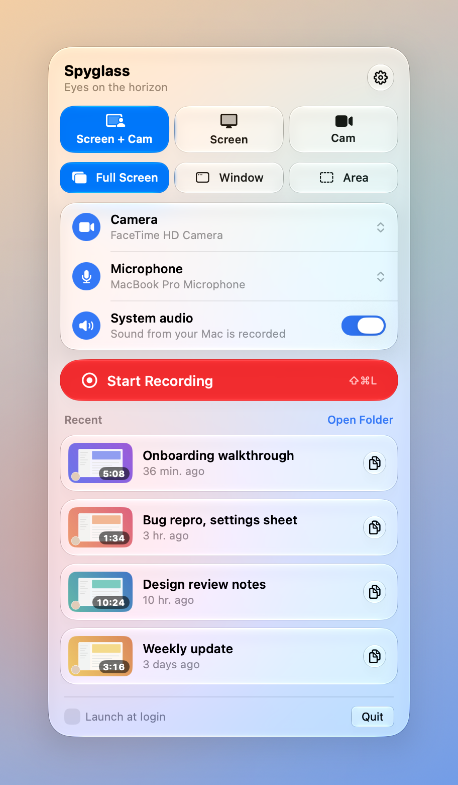

# 🔭 Spyglass

A Liquid Glass menu bar app for macOS that records your screen and your face, then puts the video straight on your clipboard. It's like Loom, but entirely native and local.

<p align="center">
  <picture>
    <source media="(prefers-color-scheme: dark)" srcset="docs/screenshot-dark.png">
    
  </picture>
</p>

- **Three modes**: screen with a round camera bubble, screen only, or camera only
- **Record anything**: a full display, a single window, or an area you drag out
- **Camera bubble** with a glass rim. Drag it anywhere and hover to switch between small, medium and large. It's recorded exactly where it sits on screen.
- **Mic and system audio**, mixed into one track so the video plays with sound everywhere
- **3-2-1 countdown** and a floating **control pill** (timer, start over, discard, stop). The pill is kept out of the video.
- **Global shortcuts**: ⌘⇧L starts and stops, ⌘⇧D discards while recording. You can change both in Settings.
- **When you stop**, the MP4 is saved to `~/Movies/Spyglass`, copied to the clipboard (paste it into Slack, Mail, or Messages), and opened in a review window where you can trim the ends, rename, or share
- **Recent recordings** in the panel: click to watch and trim, copy, drag into any app, rename, or trash
- **Quality**: H.264 up to 1080p (plays anywhere) or HEVC at native resolution (sharper and smaller)

Built with SwiftUI, ScreenCaptureKit, AVFoundation, and the macOS Liquid Glass APIs. No dependencies.

## Download

[Download Spyglass.zip](https://github.com/cadeross/Spyglass/releases/latest/download/Spyglass.zip) from the latest [release](https://github.com/cadeross/Spyglass/releases/latest), unzip it, and drag Spyglass.app into Applications. It runs on Apple silicon and Intel Macs with macOS 26 or later.

Spyglass isn't notarized yet, so the first time you open it macOS says it can't check it for malicious software. Click **Done**, open **System Settings → Privacy & Security**, scroll down, and click **Open Anyway** next to Spyglass. You only need to do this once. (Or run `xattr -dr com.apple.quarantine /Applications/Spyglass.app` in Terminal.)

## Requirements

- macOS 26 or later
- Xcode 26 or later and [XcodeGen](https://github.com/yonaskolb/XcodeGen) (`brew install xcodegen`) to build

## Building

```sh
xcodegen generate
xcodebuild -scheme Spyglass -configuration Release -derivedDataPath build build
cp -R build/Build/Products/Release/Spyglass.app /Applications/
```

The Xcode project is generated from `project.yml` and isn't checked in.

The first time you record, macOS asks for Screen Recording, Camera, and Microphone access. The app is ad-hoc signed, so macOS may ask for Screen Recording access again after each rebuild.

## How it works

- **Screen recordings** use one ScreenCaptureKit stream with an `SCRecordingOutput` writing straight to an MP4. System audio and the microphone come through the same stream. Spyglass's pill and outline windows are excluded from the capture, but the camera bubble is included.
- **Window recordings** capture only the chosen window and the bubble, so anything that overlaps the window is left out.
- **Camera-only recordings** use `AVCaptureMovieFileOutput`.
- **Finishing**: ScreenCaptureKit writes the mic and system audio as separate tracks, and most non-Apple players only play the first one. So once a recording stops, Spyglass copies the video track as-is and mixes all the audio into a single AAC track (`MovieFinisher`).
- **Trimming** uses `AVPlayerView`'s built-in trim UI and re-exports the kept range.
- **Global shortcuts** use Carbon's hot key API, which needs no Accessibility permission.

## Development tips

- `open Spyglass.app --args -SpyglassPreview YES` opens the panel in a standalone window over a backdrop, for screenshots. Add `-SpyglassAppearance light` or `dark` to force a theme. Preview mode never saves settings, so you can pass demo ones as launch arguments without touching your real ones. Settings are JSON, so pass them hex-encoded, e.g. `-folder "<$(printf '"/path/to/demo"' | xxd -p | tr -d '\n')>"` to show a folder of demo recordings.
- The app icon is a layered Liquid Glass icon in `Spyglass/AppIcon.icon` (SVG layers plus `icon.json`). Open it in Icon Composer to tweak it, or preview it from the command line with `ictool` (inside Icon Composer.app).

## License

MIT. See [LICENSE](LICENSE).
